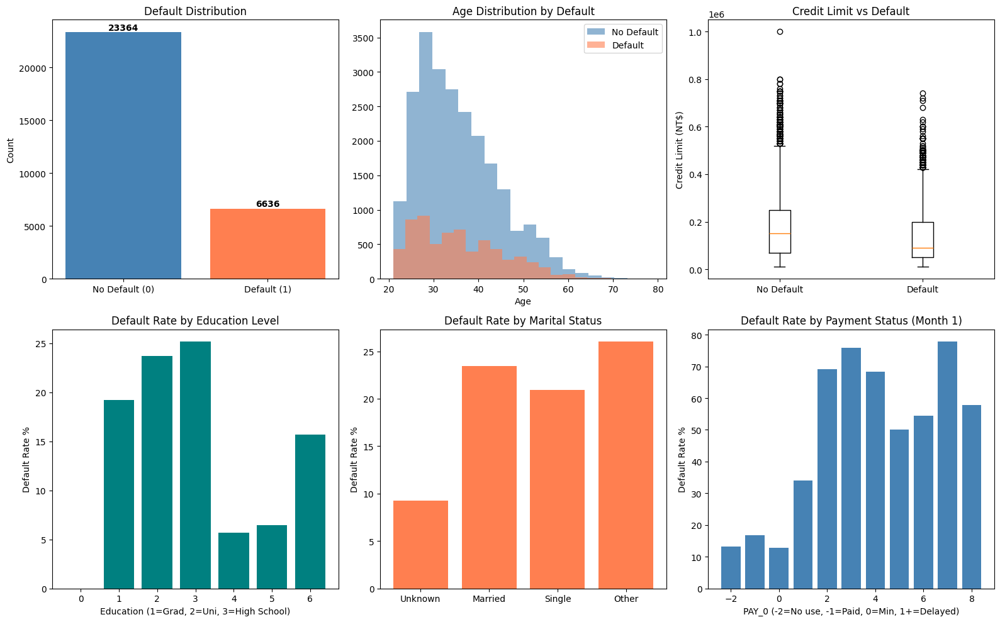
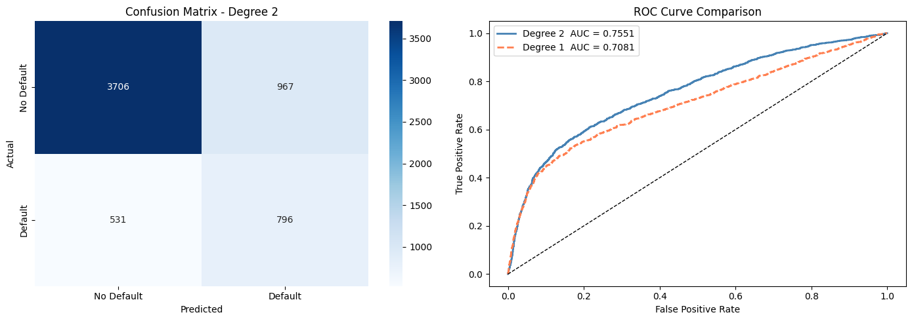

# Credit Risk Analysis

An educational Python portfolio project exploring credit-card default patterns in a dataset of 30,000 clients. It combines exploratory analysis, a comparison of logistic-regression models, and a separate Dash visualization app.

**Scope:** a portfolio exercise, not a deployed bank system or a lending decision tool. No real-world financial savings are established.

## What the project demonstrates

- Data inspection and exploration with pandas, Matplotlib and seaborn.
- A stratified train/test split and scaling fitted on training data.
- Linear versus degree-2 polynomial logistic regression with scikit-learn.
- Model evaluation using ROC-AUC, default recall, precision and a confusion matrix.
- Interactive data visualizations in Plotly Dash.

## Dataset

The included `UCI_Credit_Card.csv` contains 30,000 rows, an ID, 23 predictors and the target `default.payment.next.month`. After removing ID and target, the models use 23 input variables. There are 6,636 default cases (22.12%) and no missing cells in the included CSV.

Dataset source recorded by the original project: [UCI Default of Credit Card Clients via Kaggle](https://www.kaggle.com/datasets/uciml/default-of-credit-card-clients-dataset). The data is an educational dataset, not a customer dataset collected by this project.

## Files

| File | Purpose |
| --- | --- |
| `credit_risk_project.ipynb` | Exploration, preprocessing, model fitting and stored evaluation outputs |
| `dashboard.py` | Dataset charts, stored model-summary figures and an illustrative rules-based interaction |
| `UCI_Credit_Card.csv` | Dataset used by the notebook and app |
| `output1.png` | Saved exploratory charts |
| `output2.png` | Saved confusion matrix and ROC comparison |
| `requirements.txt` | Runtime and notebook dependencies |

## Recorded model results

These are the existing notebook outputs from one stratified 80/20 train/test split, with `random_state=42`. They were preserved, not regenerated, during the documentation and portability update.

| Metric | Linear | Degree-2 polynomial |
| --- | --- | --- |
| Accuracy | 67.97% | 75.03% |
| ROC-AUC | 0.7081 | 0.7551 |
| Default recall | Not summarized here | About 60.0% |

The stored degree-2 confusion matrix contains 3,706 true negatives, 967 false positives, 531 false negatives and 796 true positives. That corresponds to default precision of about 45.2% and a false-positive rate of about 20.7%.

Accuracy alone is misleading on this imbalanced dataset: always predicting no default gives about 77.88% accuracy. The model's default-detection trade-off should be assessed using recall, precision, false positives and ROC-AUC, not a claim that it beats that baseline on accuracy.

### Evaluation limits

The same test split was used to compare model degrees and report the selected model's performance. These are exploratory results, not an unbiased final benchmark. A stronger next step is validation/cross-validation for model choice followed by evaluation on an untouched final test set. Predicted probabilities also need calibration and domain review before any decision use.

## Model versus interactive demo

The notebook fits logistic-regression models. The Dash app does **not** load or call those trained models. Its model-summary cards and confusion matrix display stored notebook results.

The app's sliders use a small hand-written rule set based on payment delay, credit limit and age. The resulting score is an illustrative heuristic, **not a calibrated default probability or a trained-model prediction**. It must not be used to approve credit, change limits or make decisions about people.

## Financial scenario, not savings

The original analysis multiplies 796 true positives by an assumed NT$50,000 per case, giving NT$39,800,000. This is an illustrative exposure scenario only. The loss assumption is not measured, identifying a default does not prove a loss was avoided, and the calculation does not account for interventions, false positives, recoveries or costs. No realized or guaranteed savings should be inferred.

## Run locally

Use Python 3.11 or 3.12 and open a terminal in the repository root. The included CSV must remain beside `dashboard.py` and the notebook.

```bash
python -m venv .venv
```

Activate the environment:

```bash
# Windows PowerShell
.venv\Scripts\Activate.ps1

# macOS / Linux
source .venv/bin/activate
```

Install dependencies and run the app:

```bash
python -m pip install -r requirements.txt
python dashboard.py
```

Open the local address printed by Dash, normally `http://127.0.0.1:8050`. Stop the server with Ctrl+C. Debug mode is off by default. This command starts a local app; it does not deploy it to the internet.

To inspect the notebook:

```bash
jupyter lab credit_risk_project.ipynb
```

Start Jupyter from the repository root so the notebook finds the relative CSV path. The app resolves the dataset relative to its own file. Rerunning the notebook will fit the models again and can produce different output across package versions; the displayed saved results are historical outputs, not a promise of identical results in every environment.

## Visual results





## Next improvements

- Separate model selection from final testing and add a baseline comparison.
- Document categorical-variable treatment and review probability calibration.
- Connect a saved preprocessing/model pipeline only if turning the rules demo into model inference becomes a separate project goal.
- Add automated tests and a reproducible locked environment.
